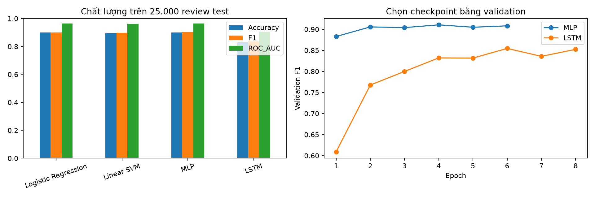

# Phân tích cảm xúc trên IMDB

So sánh LSTM với mạng neural truyền thẳng (MLP), Linear SVM và Logistic Regression trong phân loại cảm xúc đánh giá phim.

## Cấu trúc dự án

```text
IMDB_LSTM_Comparison.ipynb   # Notebook và kết quả thực nghiệm
run_experiment.py          # Chạy lại toàn bộ thí nghiệm bằng Python
requirements.txt           # Các thư viện cần thiết
results/                   # Bảng kết quả, lịch sử huấn luyện và biểu đồ
```

[Notebook](IMDB_LSTM_Comparison.ipynb) chứa mã nguồn, bảng kết quả và biểu đồ của lần chạy.



### Chạy bằng Python

```bash
pip install -r requirements.txt
python run_experiment.py
```

Lệnh này huấn luyện lại cả bốn mô hình và tạo các tệp kết quả. Dataset được tải tự động vào `data/`, thư mục này được bỏ qua khi đưa lên GitHub.

## Phương pháp

- Chọn LSTM trong nhóm RNN/LSTM/GRU.
- Phân loại tích cực/tiêu cực trên 50.000 review IMDB có nhãn.
- So sánh với mạng neural cơ bản MLP, Linear SVM và Logistic Regression.
- Train/validation/test: 20.000/5.000/25.000, dùng chung cho mọi mô hình.
- Từ vựng và IDF chỉ học trên train; checkpoint và C chọn bằng validation.
- Báo cáo accuracy, precision, recall, F1, ROC-AUC, thời gian; biểu đồ và ma trận nhầm lẫn; phân tích lỗi và hạn chế.

## Kết quả thực nghiệm

Notebook đã chạy toàn bộ trên CPU với seed 42. Các output đã được lưu trong tệp `.ipynb`.

| Mô hình | Accuracy | F1 | ROC-AUC |
|---|---:|---:|---:|
| Logistic Regression | 0.8992 | 0.8997 | 0.9632 |
| Linear SVM | 0.8964 | 0.8966 | 0.9616 |
| MLP | 0.9008 | 0.9012 | 0.9649 |
| LSTM | 0.8280 | 0.8363 | 0.9010 |

MLP có F1 cao nhất trong lần chạy. LSTM dùng tối đa 256 token đầu; khoảng 29,08% review train bị cắt. Kết quả này chỉ áp dụng cho cấu hình và một seed trong notebook, không chứng minh thứ hạng chung của các họ mô hình. Thông tin phiên bản và dấu kiểm SHA256 của dữ liệu có trong `results/run_metadata.json`.
